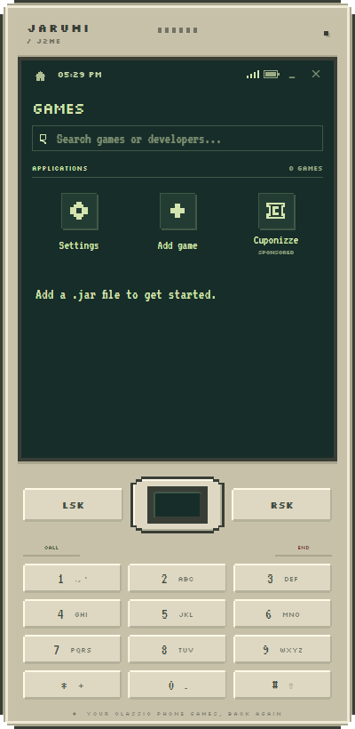
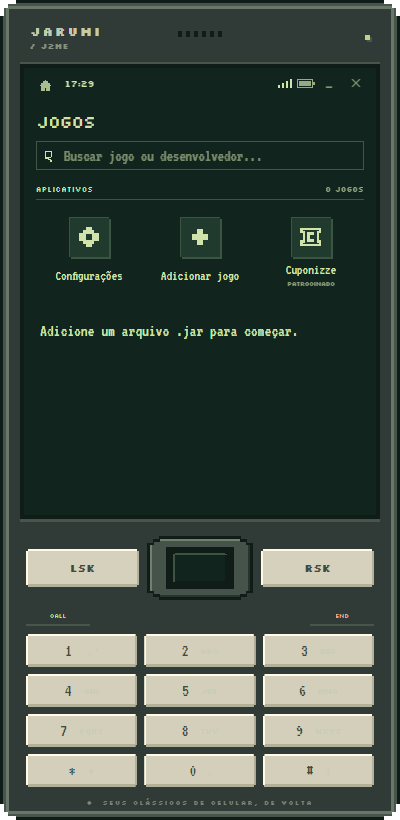
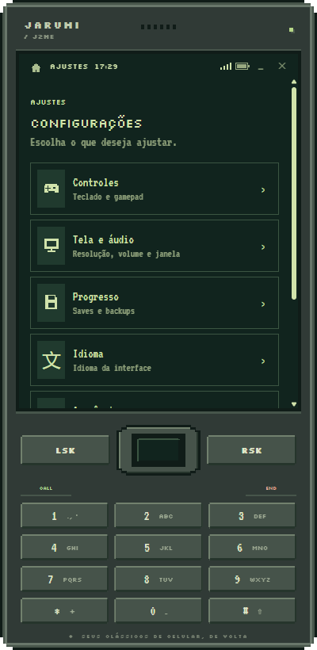
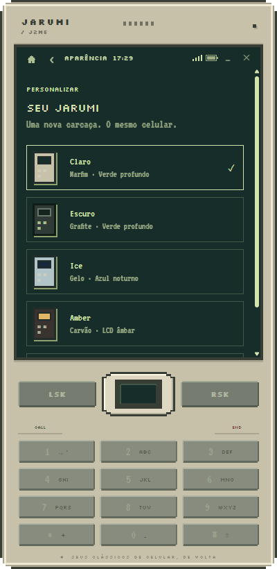
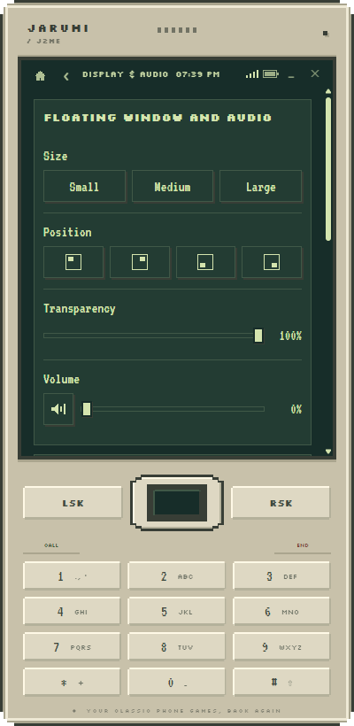
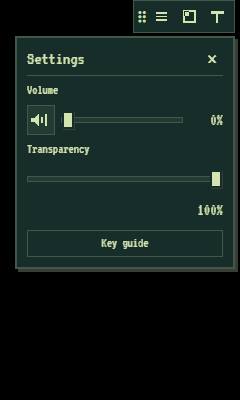

# Jarumi

Seus clássicos de celular, de volta.

Emulador desktop de aplicativos Java ME (.jar), com interface de celular em pixel art, biblioteca, temas e janela flutuante (PiP).

**Nenhum jogo é distribuído com o Jarumi.** Importe apenas arquivos que você tenha autorização para utilizar. Compatibilidade varia por jogo e versão do JAR.

## Screenshots

Capturas da interface atual com biblioteca vazia, sem jogos ou dados pessoais.

| Launcher · tema claro | Launcher · tema escuro |
| :---: | :---: |
|  |  |

| Configurações | Aparência |
| :---: | :---: |
|  |  |

| Tela e áudio | Ajustes do PiP |
| :---: | :---: |
|  |  |

## Usar no Windows

Baixe a versão mais recente em **[Releases](https://github.com/AndersonPGS/jarumi/releases/latest)**:

- `Jarumi-<versão>-Setup-x64.exe`: instalador por usuário.
- `Jarumi-<versão>-Portable-x64.exe`: executável sem instalação. Os dados continuam no perfil do usuário, não ao lado do executável.

Não é necessário instalar Node.js, Java ou clonar o código para usar esses executáveis. Os executáveis são distribuídos sem assinatura digital; não há atualização automática. Não há suporte validado para macOS, Linux ou Windows ARM.

Abra o aplicativo e use **Adicionar jogo**. Na primeira abertura de cada jogo, escolha uma resolução ou tente a detecção automática, teste e confirme. Sem metadados reconhecidos, o teste usa 240 × 320 e informa essa limitação. Altere depois pelo botão direito no jogo → Configurar tela do jogo.

## Recursos

- Launcher com favoritos pelo botão direito e jogos recentes.
- Tela vertical/horizontal e configuração de resolução por jogo.
- Teclado virtual numérico/QWERTY, teclado físico e configuração de controles.
- Temas claro e escuro; interface em português, inglês e espanhol.
- PiP com controle de volume e opacidade.
- Persistência RMS e exportação/importação de backups. Os backups de RMS não são snapshots completos da memória da máquina virtual; o suporte depende do jogo.
- Atalhos F10 (PiP), F5 (salvar) e F8 (carregar).

O launcher contém um atalho patrocinado identificado da Cuponizze, que abre o site no navegador.

## Seus dados

No aplicativo empacotado, jogos, screenshots, preferências e saves ficam em `%APPDATA%\Jarumi`. Atualizações não devem apagar essa pasta. Exporte seus saves antes de trocar de versão. Não inclua seu perfil em relatórios de bugs.

Em desenvolvimento, jogos ficam em `games/` e screenshots em `screenshots/`, fora do Git. O perfil do Electron continua sendo usado para preferências e saves. A migração do perfil antigo `J2ME PiP Emulator` preserva o original. Jogos da pasta antiga do código precisam ser importados no executável.

## Desenvolvimento

Node.js 22 ou superior e npm. No Windows:

```sh
npm ci
npm run check
npm test
npm run test:e2e
npm start
```

`npm run web` inicia o servidor em `http://127.0.0.1:8765` (ou outra porta livre). Recursos nativos de janela e importação diferem nesse modo. As fontes são locais, com licenças OFL e origem registrada em `assets/fonts/PROVENANCE.json`; a interface não precisa consultar Google Fonts.

## Gerar executáveis

```sh
npm ci
npm run dist:win
```

O build executa checks, testes HTTP, integração nativa com main/preload reais e o mesmo teste contra o app.asar gerado antes de produzir os executáveis. Os arquivos ficam em `dist/`. `npm run pack` gera a pasta de aplicativo para inspeção. O empacotamento usa uma lista explícita de arquivos: jogos, saves, testes locais e cópias de jogos ficam fora. Os runtimes `java/classes.jar` e `java/classesold.jar` são necessários ao motor e não são jogos.

A revisão das licenças e fontes correspondentes dos componentes herdados continua pendente. Consulte [a revisão de licenciamento](docs/LICENSING_REVIEW.md) e `npm run release:check`. A disponibilidade pública do repositório não encerra essa revisão.

Leia [o processo de release](docs/RELEASING.md) antes de distribuir. Leia também [as pendências da revisão](docs/PRODUCTION_REVIEW.md). Gerar um binário não significa que a distribuição pública está aprovada.

## Traduções e contribuições

Edite `locales/{pt-BR,en,es}.json` e rode `npm run build:locales`. Preserve as mesmas chaves e parâmetros nos três idiomas. Consulte [CONTRIBUTING.md](CONTRIBUTING.md). Relate problemas com versão do aplicativo, sistema e passos para reproduzir, sem anexar jogos ou dados pessoais.

## Projeto base e créditos

O motor de execução Java ME e os runtimes usados pelo Jarumi vêm da versão web de [Rosabis/J2meJS](https://github.com/Rosabis/J2meJS), baseada no [Mozilla PluotSorbet](https://github.com/mozilla/pluotsorbet). O commit de referência e as comparações de arquivos estão registrados em [UPSTREAM_EVIDENCE.json](docs/UPSTREAM_EVIDENCE.json).

O Jarumi desenvolve sua experiência desktop sobre essa base: launcher, interface de celular em pixel art, temas, idiomas, favoritos, recentes, configuração de tela por jogo, integração Electron/PiP e fluxo de distribuição. Também inclui correções locais no motor, documentadas nos [patches em relação ao upstream](docs/upstream-patches). Bibliotecas de áudio, fontes, estilos e demais componentes de terceiros conservam suas atribuições; não são apresentados como criação original do Jarumi.

## Licenças e origem

O metadado legado declara GPL-2.0, mas a árvore recebida não contém um conjunto completo de licenças/fontes e atribuições do motor e runtime. A licença geral e a redistribuição desses componentes precisam ser regularizadas antes de publicar código ou binários. Consulte [THIRD_PARTY_NOTICES.md](THIRD_PARTY_NOTICES.md). Não se presume que uma licença do launcher conceda direitos sobre jogos ou sobre componentes de terceiros.
